# BÁO CÁO ĐỀ 3 — WEBSITE QUẢNG BÁ SẢN PHẨM SỬ DỤNG WORDPRESS

**Tên website:** TechViet Store  
**Môn học:** Triển khai và Quản trị Hệ thống Phần mềm  
**Sinh viên thực hiện:** Giàng A Vàng — MSSV DTC245230011  
**Ngày hoàn thiện:** 26/10/2026  
**Môi trường triển khai:** Docker Desktop trên Windows 11 (WSL2), truy cập qua Nginx tại `http://localhost:8081`  
**Repository:** https://github.com/giangavangtg-ctrl/DTC245230011

---

## Mục lục

1. [Đặt vấn đề và mục tiêu](#1-đặt-vấn-đề-và-mục-tiêu)
2. [Phân tích yêu cầu](#2-phân-tích-yêu-cầu)
3. [Kiến trúc hệ thống](#3-kiến-trúc-hệ-thống)
4. [Triển khai Docker Compose](#4-triển-khai-docker-compose)
5. [Website TechViet Store](#5-website-techviet-store)
6. [Quản trị nội dung WordPress](#6-quản-trị-nội-dung-wordpress)
7. [Giám sát với Prometheus và Grafana](#7-giám-sát-với-prometheus-và-grafana)
8. [Logging với Loki và Promtail](#8-logging-với-loki-và-promtail)
9. [Hardening hệ thống](#9-hardening-hệ-thống)
10. [Kiểm thử và kết quả](#10-kiểm-thử-và-kết-quả)
11. [Khó khăn và cách xử lý](#11-khó-khăn-và-cách-xử-lý)
12. [Tự đánh giá theo rubric](#12-tự-đánh-giá-theo-rubric)
13. [Kết luận và hướng phát triển](#13-kết-luận-và-hướng-phát-triển)
14. [Phụ lục A — Lệnh kiểm tra nhanh](#phụ-lục-a--lệnh-kiểm-tra-nhanh)
15. [Phụ lục B — Danh sách ảnh minh chứng](#phụ-lục-b--danh-sách-ảnh-minh-chứng)
16. [Phụ lục C — Danh mục tệp và cấu hình](#phụ-lục-c--danh-mục-tệp-và-cấu-hình)

---

## 1. Đặt vấn đề và mục tiêu

### 1.1. Bối cảnh

Trong bối cảnh chuyển đổi số, một cửa hàng công nghệ cần website vừa đóng vai trò “mặt tiền” thương hiệu, vừa là công cụ quảng bá sản phẩm và thu thập nhu cầu khách hàng. Đề tài yêu cầu xây dựng website quảng bá sản phẩm bằng WordPress, nhưng không dừng ở việc cài WordPress: hệ thống phải được đóng gói bằng Docker Compose, công bố qua Nginx, có HTTPS, có giám sát metrics, thu thập log tập trung và được hardening ở mức phù hợp với môi trường lab.

TechViet Store được chọn làm thương hiệu giả định cho một chuỗi bán lẻ công nghệ tại TP. Hồ Chí Minh. Website hướng tới ba nhóm sản phẩm chính: laptop, điện thoại và phụ kiện công nghệ.

### 1.2. Mục tiêu

1. Xây dựng website quảng bá sản phẩm có giao diện chuyên nghiệp, responsive, nội dung tiếng Việt và hình ảnh cục bộ.
2. Giữ khả năng quản trị nội dung bằng WordPress Admin/Gutenberg, WP-CLI và REST API.
3. Triển khai đầy đủ thành phần hạ tầng bằng Docker Compose: WordPress, MySQL, phpMyAdmin, Nginx, Prometheus, Grafana, Loki, Promtail và các exporter.
4. Cấu hình Nginx làm reverse proxy, bổ sung security headers và HTTPS self-signed.
5. Giám sát tài nguyên container, Nginx và MySQL bằng Prometheus + Grafana với dữ liệu thật.
6. Thu thập log tập trung bằng Loki + Promtail, kiểm chứng label và viết các truy vấn LogQL có kết quả.
7. Áp dụng các biện pháp hardening và ghi nhận trung thực các ngoại lệ.
8. Kiểm thử hệ thống theo checklist, lưu ảnh minh chứng và tài liệu hóa toàn bộ quá trình.

### 1.3. Phạm vi

- Hệ thống chạy cục bộ trên máy cá nhân, không triển khai ra Internet.
- Dữ liệu sản phẩm là dữ liệu mẫu phục vụ học tập, không phải dữ liệu kinh doanh thật.
- Chứng chỉ HTTPS là self-signed, chỉ dùng cho lab.
- Không cấu hình SMTP; form liên hệ lưu dữ liệu vào WordPress và gọi `wp_mail()` ở chế độ “best effort”.

---

## 2. Phân tích yêu cầu

Bảng dưới đây đối chiếu yêu cầu của đề với cách hiện thực và minh chứng tương ứng.

| Yêu cầu | Cách hiện thực | Minh chứng |
|---|---|---|
| Website chạy tại `http://localhost:8081` | Nginx bind `127.0.0.1:8081`, proxy tới WordPress | Ảnh trang chủ, `curl -I` trả 200 |
| Giao diện chuyên nghiệp, responsive | Theme `techviet-store`, CSS thuần, 7 breakpoint `@media` | Ảnh desktop 1440px, mobile 390px |
| Header, logo, menu, hotline | `header.php`, logo SVG cục bộ, menu `TechViet Primary` | Ảnh trang chủ/mobile menu |
| Hero đúng thông điệp | “Công nghệ hiện đại – Nâng tầm trải nghiệm” | Ảnh `homepage-full.png` |
| Danh mục Laptop/Điện thoại/Phụ kiện | Taxonomy `danh_muc_sp` với 3 term | Ảnh `products.png`, kiểm tra term |
| Sản phẩm nổi bật có ảnh/tên/mô tả/giá/nút | CPT `san_pham` + meta + template card | Ảnh trang chủ, danh sách sản phẩm |
| Trang chi tiết sản phẩm | `single-san_pham.php`, thông số, sản phẩm liên quan | Ảnh `product-detail.png` |
| Dịch vụ/bảo hành, liên hệ, footer | Các section trên trang chủ + trang chính sách | Ảnh trang chủ |
| Hình ảnh cục bộ, không URL ngoài | SVG trong `assets/images`, fallback theo slug | Kiểm tra `src` ảnh đều thuộc domain nội bộ |
| Nội dung tiếng Việt thật | Nội dung viết tay trong seed script/Gutenberg | Ảnh và cơ sở dữ liệu |
| Chỉnh sửa bằng WordPress Admin | Gutenberg + meta box + CPT UI | Ảnh `wp-admin-product-edit.png` |
| Trang chủ tĩnh | `show_on_front=page`, `page_on_front=6` | WP-CLI kiểm tra |
| Menu/nút hoạt động | Menu 7 mục, link tương đối, route đúng | Kiểm tra HTTP status các URL |
| Docker Compose đầy đủ | 12 service (11 thường trực + wpcli), 6 volume, 3 network | `docker compose ps` |
| Nginx reverse proxy + headers + HTTPS | `default.conf` cấu hình HTTP/HTTPS | `nginx -t`, `curl -I` |
| Prometheus + exporter | 4 job: prometheus, docker, mysql, nginx | Ảnh `prometheus-targets.png` |
| Grafana dashboard dữ liệu thật | 3 dashboard provision + 2 datasource | Ảnh `grafana-docker.png`, `grafana-nginx.png` |
| Loki/Promtail + LogQL | Docker SD, label chuẩn, 4 query thực tế | Phần 8 và log trong Grafana |
| Hardening | Loopback port, least privilege, headers, `.env` | Bảng mục 9 |
| README + báo cáo + ảnh | Tài liệu trong repo | `README.md`, báo cáo này |

---

## 3. Kiến trúc hệ thống

### 3.1. Sơ đồ tổng thể

```
Browser
  │  http://localhost:8081  /  https://localhost:8443
  ▼
Nginx (reverse proxy, TLS, security headers)
  │ frontend network
  ├──────────────► WordPress (Apache + PHP)
  │                     │ backend network
  │                     ▼
  │                  MySQL 8.0
  │                     ▲
  │                  phpMyAdmin (loopback :8080)
  │
  └──────────────► nginx-prometheus-exporter :9113
                        │ monitoring network
                        ▼
Prometheus :9090 ─────► Grafana :3000
      ▲                    ▲
      │                    │
Telegraf :9273        Loki :3100
mysqld-exporter :9104      ▲
                           │
                       Promtail (Docker socket)
```

### 3.2. Phân tách mạng

| Network | Thành viên | Mục đích |
|---|---|---|
| `backend` | `db`, `wordpress`, `phpmyadmin`, `wpcli`, `mysqld-exporter` | Truy cập DB; MySQL không publish cổng |
| `frontend` | `nginx`, `wordpress`, `nginx-exporter` | Nginx ↔ WordPress; exporter đọc `stub_status` |
| `monitoring` | `prometheus`, `grafana`, `loki`, `promtail`, `docker-metrics`, `mysqld-exporter`, `nginx-exporter` | Thu thập metrics/log |

Ghi chú: `backend` để `internal: false` vì Docker Desktop trên Windows không phân giải DNS nội bộ ổn định trong mạng `internal`. Bù lại, MySQL không publish cổng và chỉ các container gắn `backend` mới kết nối được. Đây là đánh đổi đã được ghi rõ, không phải sơ suất.

### 3.3. Volume

| Volume | Dữ liệu |
|---|---|
| `db_data` | Toàn bộ dữ liệu MySQL |
| `wordpress_data` | Mã nguồn WordPress, plugin, theme, uploads |
| `prometheus_data` | TSDB metrics (retention 15 ngày) |
| `grafana_data` | Dashboard, user, cấu hình Grafana |
| `loki_data` | Log đã thu thập |
| `promtail_positions` | Vị trí đọc log của Promtail (giữ qua restart) |

Named volume giúp dữ liệu tồn tại qua `docker compose down` và `up` lại. Chỉ `down -v` mới xoá dữ liệu; tài liệu cảnh báo rõ.

### 3.4. Luồng request

1. Trình duyệt gửi request tới `127.0.0.1:8081`.
2. Nginx nhận request, thêm security headers, chuyển tiếp tới `wordpress:80` qua biến upstream và resolver `127.0.0.11`.
3. WordPress xử lý PHP, truy vấn MySQL qua `db:3306`.
4. WordPress trả HTML; Nginx ẩn `X-Powered-By`, trả response cho trình duyệt.
5. Với HTTPS, Nginx dùng cert self-signed, thêm HSTS, chuyển `X-Forwarded-Proto: https`.
6. WordPress đọc `HTTP_HOST` và `X-Forwarded-Proto` để sinh URL động, tránh lệch scheme/port.

---

## 4. Triển khai Docker Compose

### 4.1. Danh sách service

| Service | Image | Port host | Healthcheck | Ghi chú |
|---|---|---|---|---|
| `db` | mysql:8.0.40 | — | `mysqladmin ping` | Chỉ backend |
| `wordpress` | wordpress:6.7.2-apache | — | Kiểm tra HTML + lỗi DB | Chỉ backend + frontend |
| `phpmyadmin` | phpmyadmin:5.2.2-apache | `127.0.0.1:8080` | HTTP | Quản trị DB |
| `nginx` | nginx:1.27-alpine | `127.0.0.1:8081`, `127.0.0.1:8443` | `/nginx-health` | Reverse proxy |
| `prometheus` | prom/prometheus:v2.54.1 | `127.0.0.1:9090` | `/-/healthy` | Metrics |
| `grafana` | grafana/grafana:11.2.2 | `127.0.0.1:3000` | `/api/health` | Dashboard |
| `loki` | grafana/loki:3.2.0 | `127.0.0.1:3100` | `/ready` | Log store |
| `promtail` | grafana/promtail:3.2.0 | — | `/ready` | Log collector |
| `docker-metrics` | telegraf:1.31 | — | `/metrics` | Container metrics |
| `mysqld-exporter` | prom/mysqld-exporter:v0.14.0 | — | `/metrics` | MySQL metrics |
| `nginx-exporter` | nginx/nginx-prometheus-exporter:1.3.0 | — | Không (distroless) | Nginx metrics |
| `wpcli` | wordpress:cli-2.11.0 | — | — | Profile `tools` |

### 4.2. Thứ tự khởi động

- MySQL healthy → WordPress mới start.
- WordPress healthy → Nginx mới start.
- Prometheus healthy → Grafana mới start.
- Loki healthy → Promtail mới start.
- Exporters chờ DB/Nginx healthy.

Healthcheck WordPress không chỉ kiểm tra HTTP 200 mà còn tìm chuỗi “Error establishing a database connection”, vì trang lỗi DB của WordPress vẫn có thể trả 200. Đây là chi tiết quan trọng để tránh báo “healthy” giả.

### 4.3. Kết quả khởi động thực tế

```
NAME                  IMAGE                                   STATUS
de3_docker_metrics    telegraf:1.31                           Up (healthy)
de3_grafana           grafana/grafana:11.2.2                  Up (healthy)
de3_loki              grafana/loki:3.2.0                      Up (healthy)
de3_mysql             mysql:8.0.40                            Up (healthy)
de3_mysqld_exporter   prom/mysqld-exporter:v0.14.0            Up (healthy)
de3_nginx             nginx:1.27-alpine                       Up (healthy)
de3_nginx_exporter    nginx/nginx-prometheus-exporter:1.3.0   Up
de3_phpmyadmin        phpmyadmin:5.2.2-apache                 Up (healthy)
de3_prometheus        prom/prometheus:v2.54.1                 Up (healthy)
de3_promtail          grafana/promtail:3.2.0                  Up (healthy)
de3_wordpress         wordpress:6.7.2-apache                  Up (healthy)
```

`nginx-exporter` không có healthcheck vì image distroless không có `wget`/`curl`; trạng thái thật được xác minh qua Prometheus target `nginx` = UP.

### 4.4. WordPress và theme

- Theme `techviet-store` là theme classic tự phát triển, mount read-only vào container.
- Plugin `techviet-core` đăng ký CPT `san_pham`, taxonomy `danh_muc_sp`, CPT `tv_lien_he` và shortcode form liên hệ.
- Theme có các template: `front-page.php`, `archive-san_pham.php`, `single-san_pham.php`, `taxonomy-danh_muc_sp.php`, `page-gioi-thieu.php`, `page-lien-he.php`, `404.php`.
- CSS/JS nằm trong `assets/`; không dùng CDN nên website hoạt động offline và không lộ URL ngoài.

---

## 5. Website TechViet Store

### 5.1. Trang chủ

Trang chủ gồm các khối:

1. Top bar thông báo miễn phí giao hàng.
2. Header: logo TechViet Store, menu chính, hotline, nút liên hệ, menu mobile.
3. Hero: hình minh hoạ laptop/điện thoại, tiêu đề “Công nghệ hiện đại – Nâng tầm trải nghiệm”, mô tả, hai CTA.
4. Giới thiệu thương hiệu: câu chuyện, số liệu, cam kết.
5. Danh mục sản phẩm: Laptop, Điện thoại, Phụ kiện công nghệ.
6. Sản phẩm nổi bật: 6 sản phẩm có ảnh, tên, mô tả ngắn, giá, nút xem chi tiết.
7. Dịch vụ – bảo hành: 24 tháng, đổi trả, trả góp, hỗ trợ kỹ thuật.
8. CTA liên hệ/tư vấn.
9. Footer: thông tin showroom, hotline, email, giờ mở cửa, liên kết chính sách.

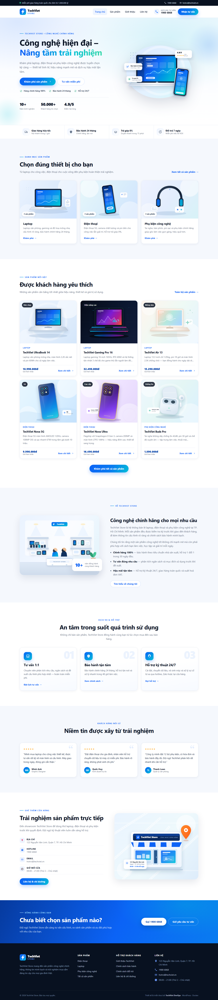

### 5.2. Danh sách và chi tiết sản phẩm

Danh sách sản phẩm dùng archive của CPT, có bộ lọc theo danh mục và card sản phẩm. Mỗi card hiển thị ảnh, nhãn, tên, mô tả ngắn, giá tham khảo và nút “Xem chi tiết”.

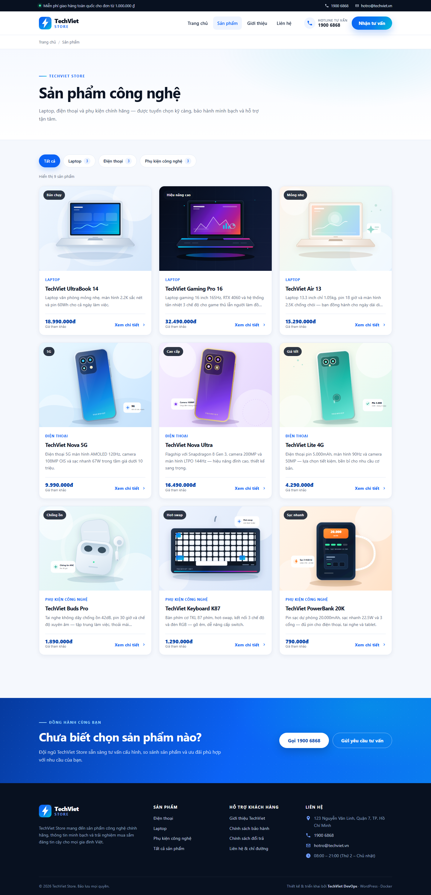

Trang chi tiết gồm ảnh lớn, tên, giá, mô tả, thông số kỹ thuật, sản phẩm liên quan và CTA tư vấn. Giá chỉ mang tính tham khảo, phù hợp mục tiêu quảng bá.

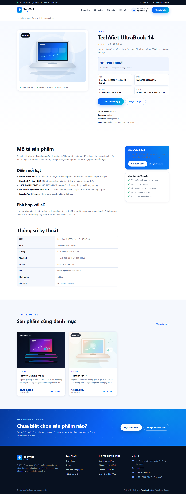

### 5.3. Giới thiệu và liên hệ

Trang giới thiệu kể câu chuyện thương hiệu, giá trị cốt lõi, showroom và cam kết dịch vụ. Trang liên hệ có thông tin hotline/email/địa chỉ, giờ mở cửa và form.

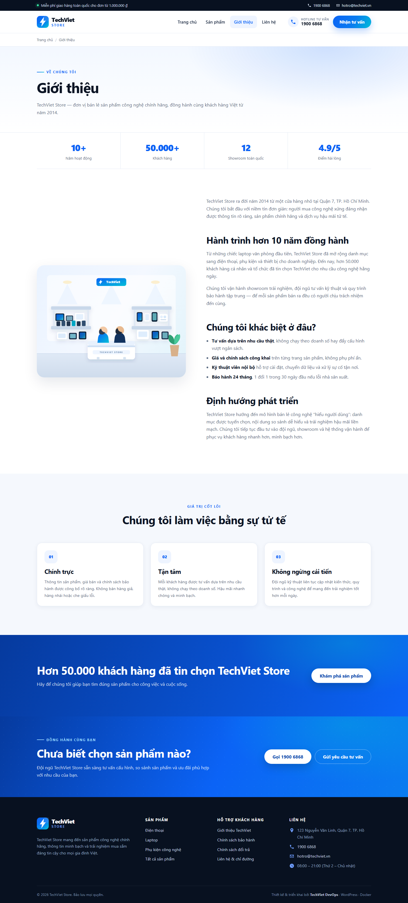

Form liên hệ có:
- Nonce WordPress (`techviet_contact_nonce`).
- Honeypot `tv_website`.
- Kiểm tra bắt buộc: họ tên, điện thoại, nội dung, đồng ý xử lý dữ liệu.
- Sanitize dữ liệu trước khi lưu.
- Lưu vào CPT `tv_lien_he` và gọi `wp_mail()` nếu môi trường cho phép.

Kết quả kiểm thử thật: gửi form bằng Chrome → chuyển tới `?lien-he=success`; entry #47 xuất hiện trong WordPress Admin. Email chưa được xác minh vì lab không có SMTP.

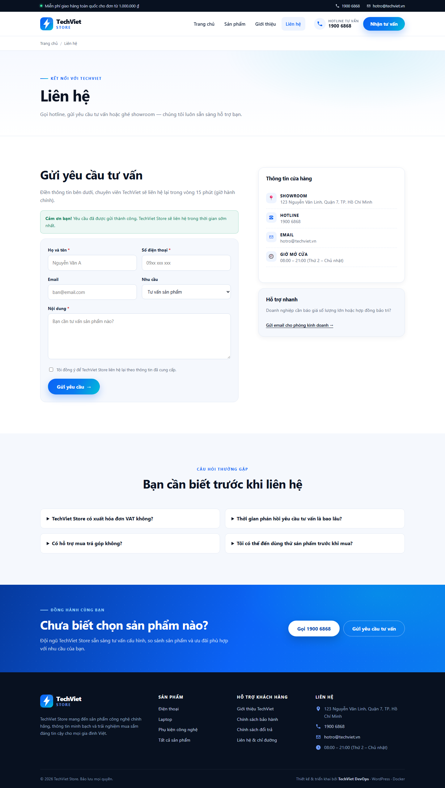

### 5.4. Responsive và menu mobile

Đã kiểm tra ở viewport 1440×1000 và 390×844:

- `document.documentElement.scrollWidth == innerWidth` → không tràn ngang.
- Nút `.tv-menu-toggle` mở menu, `aria-expanded` chuyển `true`, nav hiển thị `block`.
- Menu mobile có đủ mục và hotline.

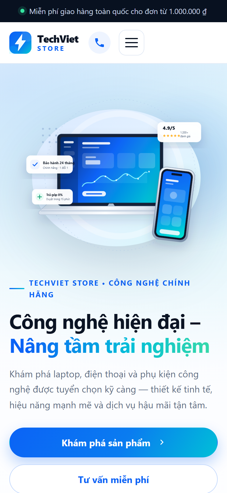

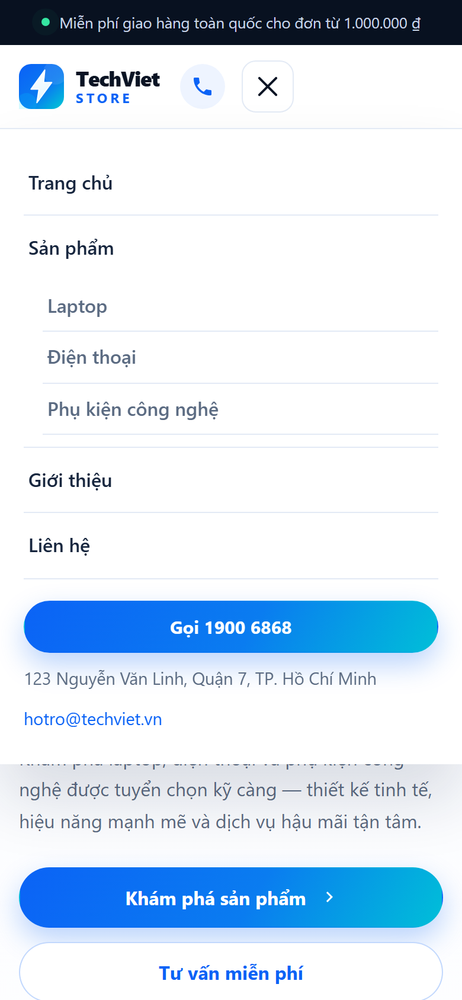

---

## 6. Quản trị nội dung WordPress

### 6.1. WordPress Admin và Gutenberg

WordPress Admin vẫn là nguồn quản trị chính. Sản phẩm là CPT riêng, có meta box “Thông tin bán hàng” chứa giá, nhãn, mô tả ngắn, thông số và trạng thái nổi bật. Trình soạn thảo Gutenberg hiển thị đầy đủ nội dung bài.

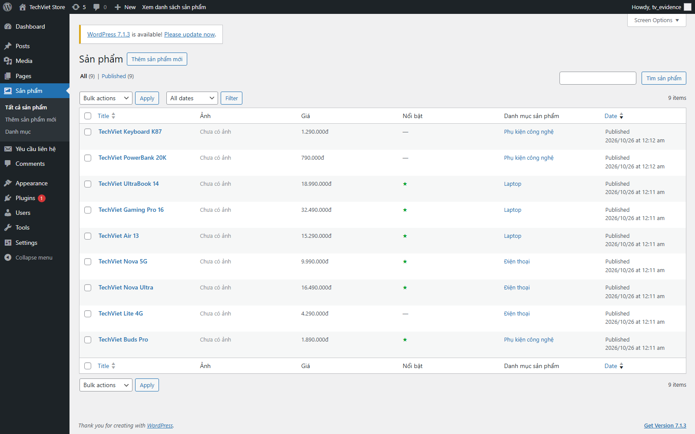

> **Lưu ý về cột Ảnh:** các sản phẩm mẫu chưa gán **Featured Image**, nên cột Ảnh trong Admin hiển thị “Chưa có ảnh”. Ngoài frontend, theme dùng ảnh minh hoạ SVG cục bộ theo slug sản phẩm (xem mục 5.2). Có thể gán Featured Image trực tiếp trong Admin để thay thế ảnh fallback mà không cần sửa code.

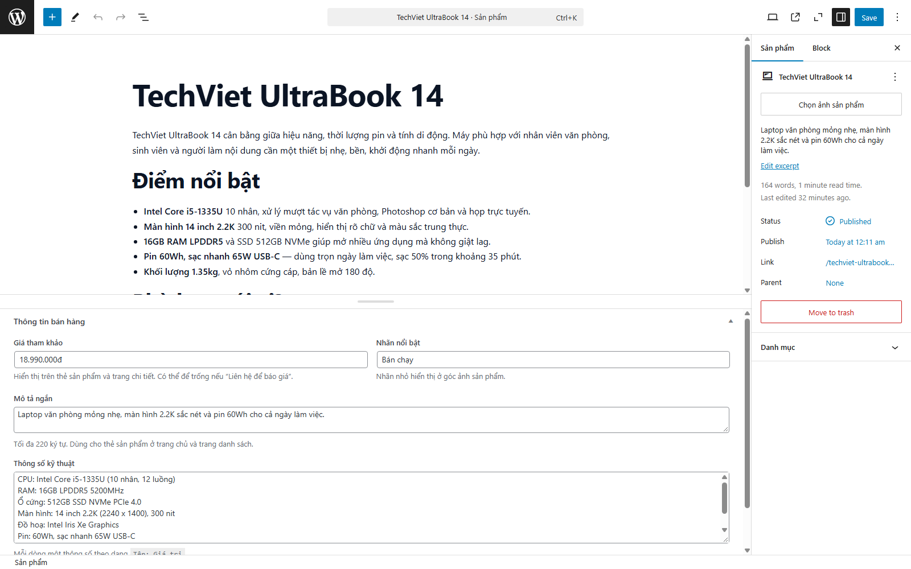

### 6.2. WP-CLI

WP-CLI chạy trong container riêng (`wpcli`) với profile `tools`, dùng chung volume WordPress và mạng backend. Các thao tác đã dùng:

```bash
docker compose --profile tools run --rm wpcli wp core version
docker compose --profile tools run --rm wpcli wp post list --post_type=san_pham
docker compose --profile tools run --rm wpcli wp option get show_on_front
docker compose --profile tools run --rm wpcli wp eval-file /tools/seed-techviet.php
```

### 6.3. REST API

Các endpoint đã kiểm tra trả 200:

- `/wp-json/`
- `/wp-json/wp/v2/pages`
- `/wp-json/wp/v2/san_pham`

CPT và taxonomy bật `show_in_rest`, cho phép đọc dữ liệu và mở đường cho tích hợp ứng dụng khác.

### 6.4. Nội dung hiện có

- 9 sản phẩm: UltraBook 14, Gaming Pro 16, Air 13, Nova 5G, Nova Ultra, Lite 4G, Buds Pro, Keyboard K87, PowerBank 20K.
- 3 danh mục, mỗi danh mục 3 sản phẩm.
- 5 trang nội dung chính + trang chủ tĩnh.
- Menu 7 mục, có menu con theo danh mục.

---

## 7. Giám sát với Prometheus và Grafana

### 7.1. Prometheus targets

Cấu hình 4 job:

| Job | Target | Ý nghĩa |
|---|---|---|
| `prometheus` | `localhost:9090` | Tự giám sát |
| `docker` | `docker-metrics:9273` | Metrics container từ Telegraf |
| `mysql` | `mysqld-exporter:9104` | Metrics MySQL |
| `nginx` | `nginx-exporter:9113` | Metrics Nginx |

Kết quả: **4/4 target UP**, không có lỗi scrape.

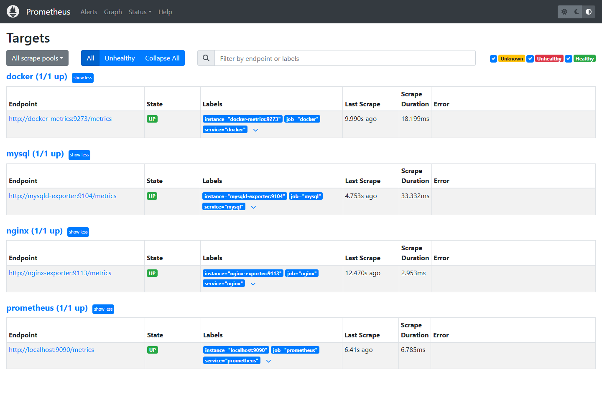

### 7.2. Vì sao thay cAdvisor bằng Telegraf

Ban đầu hệ thống dùng cAdvisor. Trên Docker Desktop Windows/WSL2, cAdvisor chỉ đọc được cgroup gốc `/`, log báo “failed to identify the read-write layer ID”, và metrics không gắn với container. Đã thử:

- Chạy privileged.
- `--cgroupns=host`.
- Mount containerd socket.
- Bỏ `--docker_only`.

Không cấu hình nào cho metrics theo container. Telegraf đọc Docker Engine API qua socket, hoạt động ổn định và trả metrics theo từng container. Đây là thay đổi có căn cứ, không phải “đổi cho đẹp”.

### 7.3. Metrics thực tế

Các metric Telegraf sử dụng:

- `docker_container_cpu_usage_percent`
- `docker_container_mem_usage`
- `docker_container_net_rx_bytes`, `docker_container_net_tx_bytes`
- `docker_container_status_uptime_ns`

Ngoài ra:

- Nginx: `nginx_up`, `nginx_connections_active`, `nginx_http_requests_total`.
- MySQL: `mysql_global_status_threads_connected`, `mysql_global_status_uptime`, `mysql_global_status_queries`.

### 7.4. Grafana dashboards

Ba dashboard được provision tự động:

1. **Docker Containers Overview** — số container, CPU %, RAM, network RX/TX, uptime, bảng trạng thái và log Loki.
2. **Nginx & Dịch vụ** — Nginx UP, connections, MySQL connected/uptime, requests/s, connections/s, MySQL QPS, log Nginx & WordPress.
3. **MySQL Overview** — connections, QPS, uptime, InnoDB.

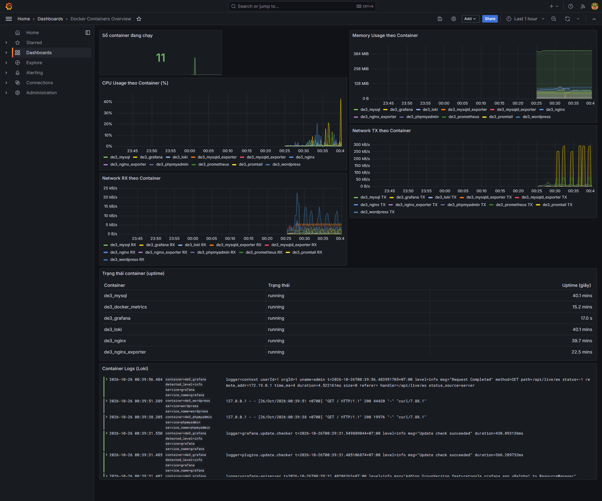

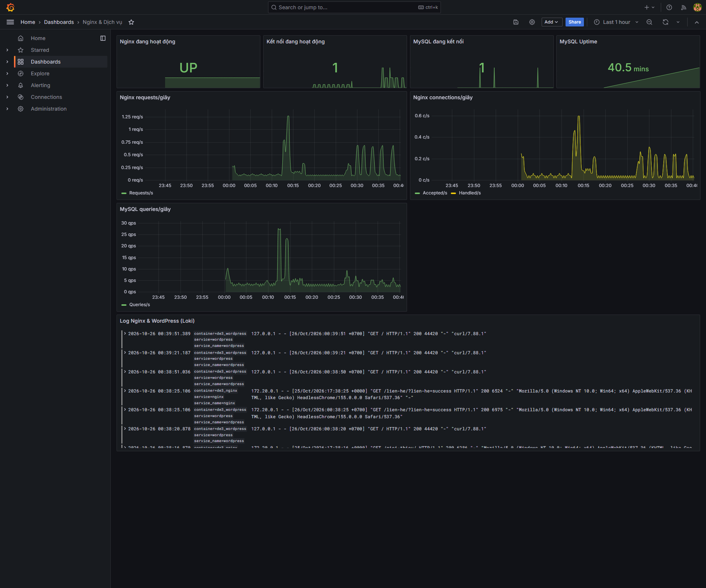

Dashboard hiển thị dữ liệu thật: 11 container, CPU/RAM/network biến động theo thời gian, Nginx UP, MySQL Uptime ~40 phút, QPS và requests/s có giá trị. Các panel log Loki hiển thị dòng log thật sau khi khai báo UID datasource cố định.

---

## 8. Logging với Loki và Promtail

### 8.1. Kiến trúc logging

- Promtail dùng `docker_sd_configs` để tự phát hiện container đang chạy.
- Log được gắn nhãn `compose_project`, `container`, `service`, `service_name`, `image`.
- Promtail đẩy log về `http://loki:3100/loki/api/v1/push`.
- Loki lưu log trong volume `loki_data`; Promtail lưu vị trí đọc trong volume `promtail_positions` để không gửi lại log cũ sau restart; Grafana truy vấn qua datasource Loki.

### 8.2. Nhãn đã kiểm chứng

```
labels: compose_project, container, service, service_name
compose_project = de3-wordpress
service = cadvisor, db, docker-metrics, grafana, loki, mysqld-exporter,
          nginx, nginx-exporter, phpmyadmin, prometheus, promtail, wordpress
container = de3_mysql, de3_wordpress, de3_nginx, de3_grafana, ...
```

Sự xuất hiện của `cadvisor`/`tv-cadvisor-test` trong danh sách label là dấu vết lịch sử của quá trình thử nghiệm trước khi chuyển sang Telegraf; các container này không còn chạy và không nằm trong dashboard.

### 8.3. LogQL đã chạy

```logql
{compose_project="de3-wordpress"}
{service="nginx"} |= "GET"
{service="nginx"} |= "/lien-he/"
{service="wordpress"} |= "POST"
{service="db"}
{service="phpmyadmin"}
{service="grafana"} |= "level=error"
```

Kết quả thực tế trong 1 giờ:

- Query toàn project: 4 stream, 200 dòng (giới hạn).
- `nginx` + `GET`: có dữ liệu, gồm request `GET /lien-he/?lien-he=success HTTP/1.1 200`.
- `nginx` + `/lien-he/`: 33 dòng.
- `wordpress` + `POST`: 34 dòng.
- `db`: 15 dòng, có cảnh báo `mysql_native_password` deprecated.
- `phpmyadmin`: 99 dòng.
- `grafana` + `level=error`: 78 dòng, chủ yếu lỗi khởi tạo plugin xychart không ảnh hưởng chức năng.

### 8.4. Hướng dẫn Explore

1. Mở Grafana → Explore.
2. Chọn Loki.
3. Nhập `{service="wordpress"} |= "POST"`.
4. Chọn “Last 1 hour”, bấm Run query.
5. Mở một dòng log để xem label và timestamp.

---

## 9. Hardening hệ thống

### 9.1. Bảng biện pháp

| STT | Biện pháp | Cách làm | Kiểm chứng |
|---:|---|---|---|
| 1 | Bảo vệ bí mật | `.env` + `.gitignore`; `.env.example` placeholder | `git check-ignore .env` |
| 2 | Không publish DB | MySQL không có mapping host | `docker ps` chỉ thấy `3306/tcp` |
| 3 | Không publish WordPress | WordPress chỉ `80/tcp` nội bộ | Truy cập qua Nginx |
| 4 | Loopback cho quản trị | 8080/3000/9090/3100/8081/8443 đều bind `127.0.0.1` | `docker ps` |
| 5 | Tách mạng | backend/frontend/monitoring | `docker network inspect` |
| 6 | Least privilege MySQL | `wp_user` chỉ DB; `exporter` chỉ đọc | `SHOW GRANTS` |
| 7 | no-new-privileges | Bật cho 11 container | `docker inspect` |
| 8 | Non-root khi hỗ trợ | Prometheus, Grafana, Loki, mysqld-exporter | `docker exec ... id` |
| 9 | Security headers | CSP, XFO, nosniff, Referrer, Permissions, HSTS | `curl -I` |
| 10 | Giảm lộ thông tin | `server_tokens off`, ẩn `X-Powered-By`, chặn file ẩn | `curl -I`, thử `/.env` |
| 11 | HTTPS | Self-signed TLS 1.2/1.3 | `openssl s_client` |
| 12 | WordPress | `DISALLOW_FILE_EDIT`, tắt auto-update core, prefix `wpsec_` | `wp-config` extra |
| 13 | Grafana | Tắt signup, mật khẩu từ `.env` | biến môi trường |
| 14 | phpMyAdmin | `PMA_ARBITRARY=0`, loopback | compose + `docker ps` |

### 9.2. Kết quả kiểm chứng

- `SHOW GRANTS` cho `exporter`: `PROCESS`, `REPLICATION CLIENT`, `SELECT` trên `performance_schema`.
- `SHOW GRANTS` cho `wp_user`: `ALL PRIVILEGES` trên `wordpress_db` (không phải toàn server).
- `.env` và private key đều bị `.gitignore`.
- HTTP/HTTPS trả đủ security headers; HTTPS có HSTS.
- Không còn `X-Powered-By`; chỉ một `X-Frame-Options`.
- Trang HTTPS không chứa URL `http://`.
- `no-new-privileges:true` có trên cả 11 container đang chạy.

### 9.3. Ngoại lệ và giới hạn

1. **Telegraf và Promtail chạy root** để đọc `/var/run/docker.sock`. Đã giảm thiểu: socket mount read-only, `no-new-privileges`, không publish cổng.
2. **MySQL, WordPress/Apache, phpMyAdmin, Nginx** có master process root theo image chính thức; tiến trình xử lý request drop xuống `mysql`/`www-data`/`nginx`.
3. **Backend network không internal** do giới hạn DNS Docker Desktop, bù bằng không publish cổng DB.
4. **HTTPS self-signed** chỉ dùng lab.
5. **Không có SMTP**, nên email từ form chưa được xác minh; dữ liệu vẫn lưu trong WordPress.

---

## 10. Kiểm thử và kết quả

### 10.1. Checklist 12 điểm

| # | Nội dung | Kết quả | Ghi chú |
|---:|---|:---:|---|
| 1 | Stack khởi động, health ổn định | ✅ | 11 container, 10 healthy; exporter không healthcheck nhưng target UP |
| 2 | Website qua Nginx | ✅ | HTTP 200, nội dung đúng |
| 3 | Giao diện đủ thành phần | ✅ | Hero, danh mục, sản phẩm, dịch vụ, liên hệ, footer |
| 4 | Responsive + menu mobile | ✅ | 1440px/390px, không tràn ngang, toggle hoạt động |
| 5 | Menu/liên kết/nút | ✅ | Các URL chính trả 200 |
| 6 | Danh sách/chi tiết sản phẩm, ảnh cục bộ | ✅ | 9 sản phẩm, 3 danh mục, ảnh SVG nội bộ |
| 7 | Giới thiệu/Liên hệ/form | ✅ | Entry #47; email chưa xác minh do không SMTP |
| 8 | Quản trị WordPress | ✅ | Gutenberg, WP-CLI, REST 200 |
| 9 | Nginx/HTTPS/headers | ✅ | `nginx -t` OK; HTTP/HTTPS 200; zero `http://` trên HTTPS |
| 10 | Prometheus metrics | ✅ | 4/4 target UP, dữ liệu thật |
| 11 | Grafana dashboards | ✅ | 3 dashboard, 2 datasource |
| 12 | Loki/Promtail + LogQL + hardening | ✅ | 4 label, ≥3 query có dữ liệu, hardening theo mục 9 |

### 10.2. Kiểm tra HTTP status

| URL | Status |
|---|---|
| `/` | 200 |
| `/san-pham/` | 200 |
| `/san-pham/techviet-ultrabook-14/` | 200 |
| `/danh-muc-san-pham/laptop/` | 200 |
| `/danh-muc-san-pham/dien-thoai/` | 200 |
| `/danh-muc-san-pham/phu-kien/` | 200 |
| `/gioi-thieu/` | 200 |
| `/lien-he/` | 200 |
| `/chinh-sach-bao-hanh/` | 200 |
| `/wp-json/` | 200 |
| `/wp-json/wp/v2/pages` | 200 |
| `/wp-json/wp/v2/san_pham` | 200 |
| `/wp-admin/` (chưa đăng nhập) | 302 → login (đúng) |

### 10.3. Kiểm tra bảo mật

| Kiểm tra | Kết quả |
|---|---|
| MySQL publish cổng host | Không |
| WordPress publish cổng host | Không |
| phpMyAdmin/Grafana/Prometheus/Loki public | Không, chỉ loopback |
| `.env` trong Git | Không |
| Private key trong Git | Không |
| Security headers | Đủ |
| HSTS trên HTTPS | Có |
| `X-Powered-By` | Đã ẩn |
| `no-new-privileges` | 11/11 |
| MySQL exporter least privilege | Có |

---

## 11. Khó khăn và cách xử lý

### 11.1. cAdvisor không hoạt động trên Docker Desktop

**Hiện tượng:** metrics chỉ có cgroup `/`, không có container; log báo lỗi đọc layer.  
**Nguyên nhân:** khác biệt cgroup/overlayfs giữa Docker Desktop WSL2 và Linux host.  
**Xử lý:** thay bằng Telegraf Docker input; xác minh metrics theo container trong Prometheus/Grafana.

### 11.2. Telegraf không đọc được Docker socket

**Hiện tượng:** permission denied.  
**Nguyên nhân:** entrypoint của image Telegraf drop xuống user `telegraf`.  
**Xử lý:** `user: "0:0"`, entrypoint telegraf, socket read-only, `no-new-privileges`.

### 11.3. Gutenberg trắng nội dung

**Hiện tượng:** iframe canvas không render, mặc dù dữ liệu bài có 5 block.  
**Nguyên nhân:** CSP `default-src 'self'` chặn iframe `blob:` của Gutenberg.  
**Xử lý:** thêm `frame-src 'self' blob:`, `img-src ... blob:`, `media-src ... blob:`. Sau đó editor hiển thị đúng.

### 11.4. Grafana panel Loki “No data”

**Hiện tượng:** panel logs trống dù Loki có dữ liệu.  
**Nguyên nhân:** panel không khai báo UID datasource Loki.  
**Xử lý:** gán UID cố định cho Prometheus và Loki trong toàn bộ dashboard; restart Grafana.

### 11.5. Grafana 401 với mật khẩu trong `.env`

**Nguyên nhân:** mật khẩu đã lưu trong volume khác `.env` (thay đổi sau lần khởi tạo đầu).  
**Xử lý:** reset bằng `grafana cli admin reset-admin-password`, không xoá volume.

### 11.6. Nginx 502 do DNS

**Hiện tượng:** Nginx không resolve được `wordpress` sau khi container được tạo lại.  
**Xử lý:** dùng `resolver 127.0.0.11` và biến upstream `$upstream_wordpress`, giúp resolve lúc runtime.

### 11.7. Mixed content trên HTTPS

**Hiện tượng:** menu “Trang chủ” lưu URL tuyệt đối `http://localhost:8081/`.  
**Xử lý:** đổi menu item sang `/`; WordPress sinh URL động theo `X-Forwarded-Proto`. Kiểm tra lại HTTPS không còn `http://`.

### 11.8. Test form bằng curl bị lỗi encoding

**Hiện tượng:** `tv_message` rỗng khi gửi tiếng Việt qua Git Bash.  
**Nguyên nhân:** encoding command line, không phải logic form.  
**Xử lý:** test lại bằng Chrome; dùng file UTF-8 với `--data-urlencode` nếu cần curl.

### 11.9. WP-CLI lỗi đường dẫn trên Git Bash

**Hiện tượng:** `/var/www/html` bị chuyển thành `C:/Program Files/Git/...`.  
**Xử lý:** `MSYS_NO_PATHCONV=1` trước lệnh docker.

---

## 12. Tự đánh giá theo rubric

| Tiêu chí | Tự đánh giá | Căn cứ |
|---|---|---|
| Website đúng chủ đề, giao diện đẹp | Tốt | Ảnh desktop/mobile; nội dung tiếng Việt; ảnh cục bộ |
| Đầy đủ trang và chức năng | Tốt | Trang chủ, sản phẩm, chi tiết, giới thiệu, liên hệ, chính sách |
| WordPress Admin hoạt động | Tốt | Gutenberg + meta box + CPT |
| Docker Compose đầy đủ | Tốt | 12 service, healthcheck, volume, network |
| Nginx/HTTPS/headers | Tốt | Config test, headers, HSTS |
| Prometheus/Grafana | Tốt | 4 target, 3 dashboard, dữ liệu thật |
| Loki/Promtail | Tốt | Label + 4 query thực tế |
| Hardening | Khá–Tốt | Có ngoại lệ root/socket đã ghi rõ |
| Tài liệu/README | Tốt | README chi tiết, báo cáo, ảnh minh chứng |
| Trung thực minh chứng | Tốt | Không ảnh giả; nêu rõ phần chưa kiểm chứng |

Điểm trừ tự nhận:
- Chưa cấu hình SMTP nên chưa xác minh email.
- Một số container buộc chạy root theo image.
- Chưa có backup tự động DB.
- Chưa có cảnh báo (alerting) Prometheus/Grafana.

---

## 13. Kết luận và hướng phát triển

### 13.1. Kết quả đạt được

Hệ thống TechViet Store đã chạy ổn định tại `http://localhost:8081`, đáp ứng đầy đủ yêu cầu về website quảng bá sản phẩm, quản trị WordPress, hạ tầng Docker Compose, reverse proxy Nginx, HTTPS, giám sát Prometheus/Grafana và logging Loki/Promtail. Các thành phần đều có minh chứng từ hệ thống thật: ảnh chụp, HTTP status, Prometheus target, dashboard, LogQL.

Điểm quan trọng là hệ thống không chỉ “chạy được” mà còn:
- Có healthcheck thực chất (kiểm tra cả lỗi DB).
- Có phân tách mạng và không publish DB.
- Có least-privilege cho MySQL exporter.
- Có security headers và CSP tương thích Gutenberg.
- Có log/metrics theo container, không chỉ metrics mức host.

### 13.2. Hướng phát triển

1. Cấu hình SMTP/transactional email để xác minh gửi mail từ form.
2. Thêm Prometheus Alertmanager và rule cảnh báo (container down, CPU cao, 5xx).
3. Backup định kỳ MySQL và WordPress uploads.
4. Chuyển HTTPS sang CA thật, redirect HTTP → HTTPS.
5. Thêm CI/CD kiểm tra `nginx -t`, `docker compose config`, lint PHP.
6. Tối ưu hiệu năng: cache page, nén ảnh, CDN nếu triển khai thật.
7. Bổ sung tìm kiếm/lọc sản phẩm nâng cao và giỏ hàng nếu mở rộng thương mại điện tử.

---

## Phụ lục A — Lệnh kiểm tra nhanh

```bash
# Trạng thái
docker compose ps
docker compose logs --tail=50 nginx wordpress db

# Website
curl -sI http://localhost:8081/
curl -skI https://localhost:8443/

# Prometheus
curl -s http://localhost:9090/api/v1/targets \
  | jq -r '.data.activeTargets[] | "\(.labels.job)\t\(.health)"'

# Loki labels
curl -s http://localhost:3100/loki/api/v1/labels

# WP-CLI
MSYS_NO_PATHCONV=1 docker compose --profile tools run --rm wpcli \
  wp post list --post_type=san_pham

# Nginx config
docker exec de3_nginx nginx -t

# MySQL grants (không in mật khẩu)
docker exec de3_mysql sh -c \
  'mysql -uroot -p"$MYSQL_ROOT_PASSWORD" -N -e "SHOW GRANTS FOR '\''exporter'\''@'\''%'\'';"'
```

---

## Phụ lục B — Danh sách ảnh minh chứng

Tất cả ảnh nằm trong `docs/screenshots/`, chụp từ hệ thống đang chạy ngày 26/10/2026.

| STT | Tệp | Nội dung | Kích thước |
|---:|---|---|---|
| 1 | `homepage-full.png` | Trang chủ desktop, toàn trang | 1440×6593 |
| 2 | `products.png` | Danh sách 9 sản phẩm | 1440×2984 |
| 3 | `product-detail.png` | Chi tiết TechViet UltraBook 14 | 1440×3818 |
| 4 | `about.png` | Trang giới thiệu | 1440×3180 |
| 5 | `contact-success.png` | Form liên hệ gửi thành công | 1440×2547 |
| 6 | `homepage-mobile.png` | Trang chủ mobile 390px | 780×1688 |
| 7 | `homepage-mobile-menu.png` | Menu mobile mở | 780×1688 |
| 8 | `wp-admin-products.png` | Danh sách sản phẩm trong Admin | 1600×1000 |
| 9 | `wp-admin-product-edit.png` | Gutenberg sửa sản phẩm | 1600×1000 |
| 10 | `prometheus-targets.png` | 4/4 target UP | 1440×1000 |
| 11 | `grafana-docker.png` | Dashboard Docker + log Loki | 1920×1600 |
| 12 | `grafana-nginx.png` | Dashboard Nginx/MySQL + log Loki | 1920×1600 |

---

## Phụ lục C — Danh mục tệp và cấu hình

| Tệp | Vai trò |
|---|---|
| `compose.yaml` | Định nghĩa 12 service, volume, network, healthcheck, port |
| `.env.example` | Mẫu biến môi trường, không chứa mật khẩu thật |
| `.gitignore` | Bỏ qua `.env`, SSL key/cert, log, data, IDE |
| `nginx/conf.d/default.conf` | Reverse proxy HTTP/HTTPS, headers, CSP, stub_status |
| `prometheus/prometheus.yml` | 4 scrape job |
| `grafana/provisioning/datasources/datasources.yml` | Prometheus + Loki |
| `grafana/provisioning/dashboards/*.json` | 3 dashboard |
| `loki/loki-config.yml` | Cấu hình Loki |
| `promtail/promtail-config.yml` | Docker service discovery + label + pipeline |
| `telegraf/telegraf.conf` | Docker input + Prometheus output :9273 |
| `tools/seed-techviet.php` | Seed nội dung mẫu |
| `wordpress/wp-content/themes/techviet-store/` | Theme giao diện |
| `wordpress/wp-content/plugins/techviet-core/` | CPT, taxonomy, form liên hệ |

---

**Hết báo cáo.**
